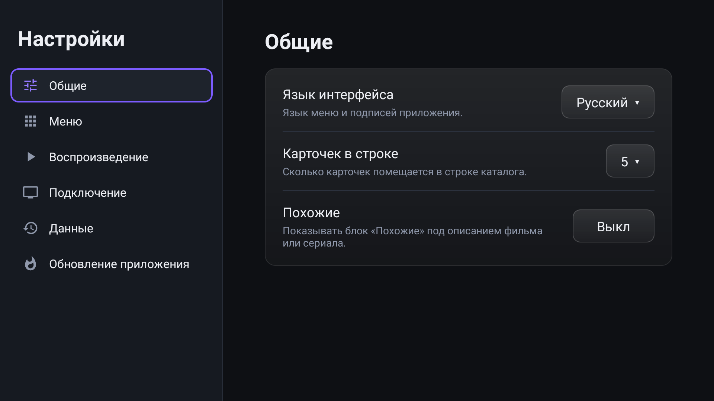
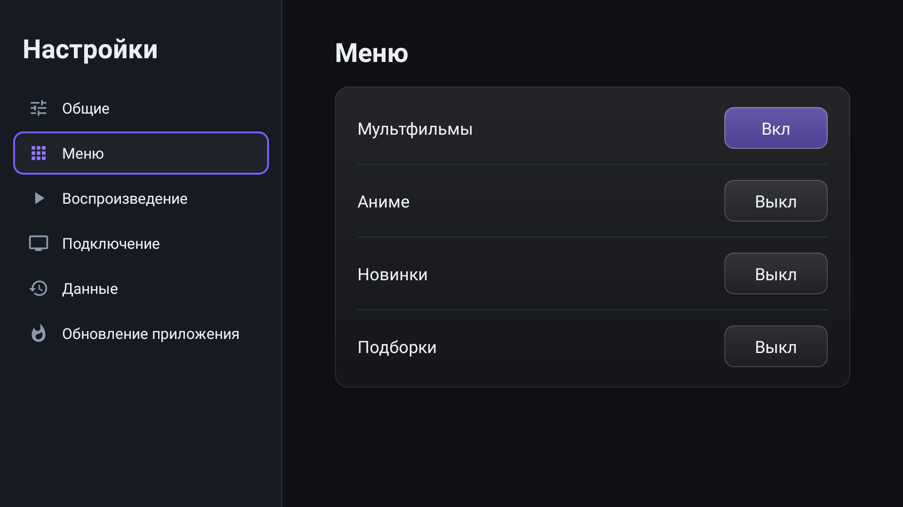
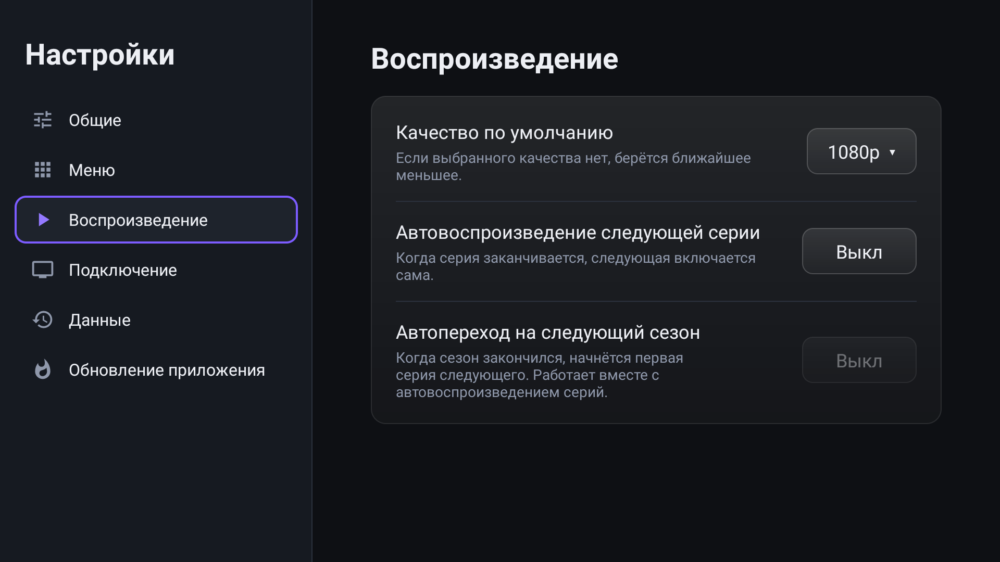
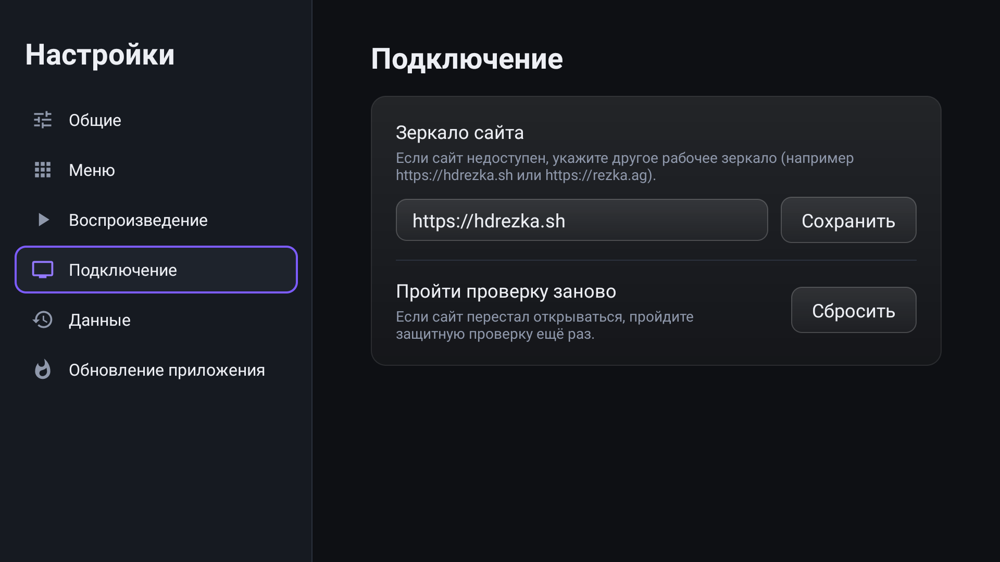

# HDRezka TV

Приложение для Android TV: каталог фильмов и сериалов, поиск, выбор озвучки, сезона, серии и качества, воспроизведение
прямо на телевизоре с пульта. Управление рассчитано на обычный пульт со стрелками, кнопкой OK и «Назад».

> **Неофициальное приложение.** Оно не связано с сайтом HDrezka и его владельцами и ничего не хранит на своих серверах:
> показывает то, что отдаёт сам сайт. Ответственность за просматриваемый контент лежит на пользователе.

Этот репозиторий содержит **только готовые сборки** (вкладка [Releases](https://github.com/kholodniakruslan/HDRezka-releases/releases)).
Исходный код закрыт.

**[Скачать последнюю версию](https://github.com/kholodniakruslan/HDRezka-releases/releases/latest)**

## Что умеет приложение

- **Каталог:** Главная, Фильмы, Сериалы, Мультфильмы. Аниме, Новинки и Подборки включаются в настройках.
  В каталоге есть фильтры и жанры, прокрутка подгружает следующие страницы сама.
- **Поиск** по фильмам и сериалам (поле вверху главной страницы).
- **Страница фильма или сериала:** постер, рейтинги, описание, режиссёр и актёры, выбор озвучки, сезона, серии и качества,
  блок «Похожие» (по желанию), кнопка «В избранное».
- **Продолжить просмотр:** приложение запоминает, где вы остановились. На главной появляется ряд «Продолжить просмотр»,
  на странице фильма кнопка «Продолжить 12:30».
- **История и Избранное** хранятся на самом телевизоре. Аккаунт не нужен.
- **Плеер:** перемотка, смена серии, озвучки и качества прямо во время просмотра, субтитры (если они есть у видео),
  автоматический переход на следующую серию и следующий сезон (настраивается).
- **Языки интерфейса:** русский, украинский, английский. По умолчанию язык берётся из системы.
- **Обновления прямо из приложения:** новая версия предлагается при запуске, устанавливается в пару нажатий.

## Что нужно для работы

- Телевизор или приставка на **Android 10 и новее** (Android TV, Google TV).
- Процессор ARM: 64-битный (`arm64-v8a`, большинство современных устройств) или 32-битный (`armeabi-v7a`, например некоторые Xiaomi Mi TV).
- Доступ в интернет.
- Достаточно свежий **Android System WebView**: он нужен, чтобы пройти защитную проверку сайта. На реальных телевизорах он
  обновляется через Google Play.

## Установка

1. Откройте [последний релиз](https://github.com/kholodniakruslan/HDRezka-releases/releases/latest) и скачайте файл `.apk`:
   - `HDRezka-TV-<версия>-arm64-v8a.apk` для 64-битных устройств;
   - `HDRezka-TV-<версия>-armeabi-v7a.apk` для 32-битных.

   Если не уверены, начните с `arm64-v8a`. Если установка пишет, что пакет не подходит устройству, возьмите `armeabi-v7a`.
2. Перенесите файл на телевизор одним из способов:
   - **Флешка:** скопируйте APK на флешку, вставьте в телевизор и откройте файл через любой файловый менеджер.
   - **ADB** (если на телевизоре включена отладка по сети или USB):

     ```
     adb connect <IP-адрес-телевизора>:5555
     adb install -r HDRezka-TV-<версия>-arm64-v8a.apk
     ```
3. Телевизор может запросить разрешение **«Установка из неизвестных источников»** для файлового менеджера. Разрешите его
   (пункт обычно находится в «Настройки → Безопасность и ограничения» или «Приложения»).
4. Запустите приложение **HDRezka** из списка приложений.

При первом запуске приложение несколько секунд проходит защитную проверку сайта и показывает «Подключаемся к сайту…».
Ничего нажимать не нужно.

## Как пользоваться

### Главная страница

- Слева меню: Главная, Фильмы, Сериалы, Мультфильмы, Избранное, История, Настройки, Выход.
- Вверху поле поиска. Нажмите на него пультом, введите название экранной клавиатурой.
- Стрелки перемещают фокус по карточкам, **OK** открывает страницу фильма, **«Назад»** возвращает на шаг назад.

### Страница фильма

- Кнопка **«Смотреть»** (или **«Продолжить 12:30»**, если вы уже начинали) запускает видео.
- Рядом сердечко: добавить в избранное или убрать.
- Ниже панель выбора: **Озвучка, Сезон, Серия, Качество**. Выберите нужное стрелками и OK, потом нажмите «Смотреть».

### Управление в плеере

| Кнопка пульта | Что делает |
|---|---|
| **OK** | Пауза и воспроизведение (панель управления показывается) |
| **←** и **→** | Перемотка. Если держать нажатой, шаг растёт: от 10 до 120 секунд |
| **↑** или **↓** | Показать панель управления |
| **«Назад»** | Скрыть панель, а если она скрыта, выйти из плеера |
| **Меню** | Показать панель управления |
| **Play/Pause**, **Перемотка**, **Следующая и предыдущая серия** | Если такие клавиши есть на пульте, работают так же: перемотка на 30 секунд, переключение серий |

На панели управления: прошлая и следующая серия, пауза, список серий, озвучка, качество и субтитры (если они доступны).
Позиция запоминается автоматически, при следующем запуске можно продолжить с того же места.

## Настройки

В меню слева откройте **Настройки**.

**Общие:** язык интерфейса, сколько карточек помещается в строке каталога (4, 5 или 6) и показ блока «Похожие».



**Меню:** какие разделы показывать слева. Мультфильмы включены сразу, Аниме, Новинки и Подборки можно включить.



**Воспроизведение:** качество по умолчанию (если его нет у видео, берётся ближайшее меньшее), автовоспроизведение следующей серии
и автопереход на следующий сезон.



**Подключение:** адрес зеркала сайта и сброс защитной проверки.



**Данные:** очистка истории просмотров и ряда «Продолжить просмотр».

**Обновление приложения:** текущая и последняя доступные версии, проверка вручную, кнопка обновления.

## Обновление приложения

Приложение само проверяет новые версии при запуске. Если вышла новая, появится окно **«Обновить / Позже»**. После нажатия
«Обновить» файл скачивается (прогресс виден на экране), проверяется контрольная сумма, и запускается обычный установщик
Android, где нужно подтвердить установку. Данные, история и избранное сохраняются.

Если вы нажали «Позже», проверить вручную можно в **Настройки → Обновление приложения**.

Что важно знать:

- Обновление предлагается только для стабильных версий. Предварительные (с суффиксом вроде `-rc.1`) приложение игнорирует.
- Если телевизор не разрешает установку, приложение откроет системный экран настроек, где нужно разрешить установку из этого источника.
- Если появляется сообщение «Для этого устройства нет подходящей сборки», у вашей архитектуры процессора нет APK в релизе.
  Установите нужный файл вручную из последнего релиза.
- Ошибки сети или проверки не мешают запуску: приложение просто остаётся на текущей версии.

## Если что-то не работает

| Проблема | Что сделать |
|---|---|
| Сайт не открывается или каталог пустой | **Настройки → Подключение → Пройти проверку заново → Сбросить**. Проверка пройдётся заново при следующем обращении к сайту |
| То же самое не помогло | В том же разделе укажите другое рабочее зеркало сайта, например `https://hdrezka.sh` или `https://rezka.ag`, и нажмите «Сохранить» |
| Защитная проверка не проходится | Обновите **Android System WebView** в Google Play на телевизоре |
| «Не удалось воспроизвести видео» | Выберите другое качество или другую озвучку |
| Видео долго грузится | Выберите качество ниже (панель управления → Качество) |
| Не устанавливается APK | Проверьте разрешение на установку из неизвестных источников, попробуйте другой файл (`arm64-v8a` или `armeabi-v7a`) |
| Хочется начать заново | **Настройки → Данные → Очистить**: удалит историю и «Продолжить просмотр» |

## Данные и приватность

- Настройки, история и избранное лежат только на вашем устройстве. Аккаунт для работы не нужен.
- Приложение обращается к сайту (чтобы получить каталог и видео) и к GitHub (чтобы проверить обновления).
- Сборки подписаны одним и тем же ключом, поэтому обновление встаёт поверх установленной версии без потери данных.
  Перед установкой приложение проверяет размер файла, контрольную сумму SHA-256, имя пакета и подпись.

## Вопросы и сообщения об ошибках

Откройте раздел [Issues](https://github.com/kholodniakruslan/HDRezka-releases/issues) этого репозитория
и опишите модель телевизора, версию Android, версию приложения (Настройки → Обновление приложения) и что именно не работает.
