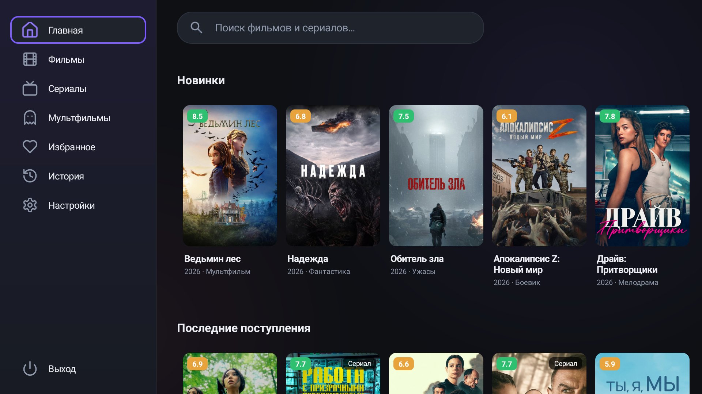
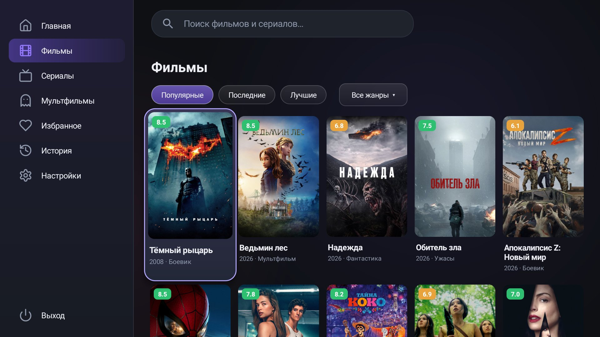
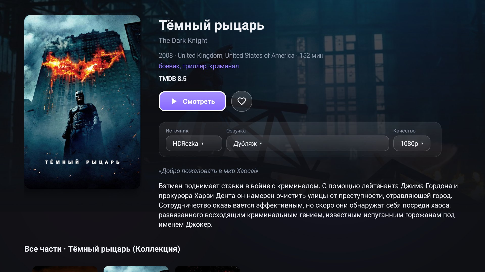
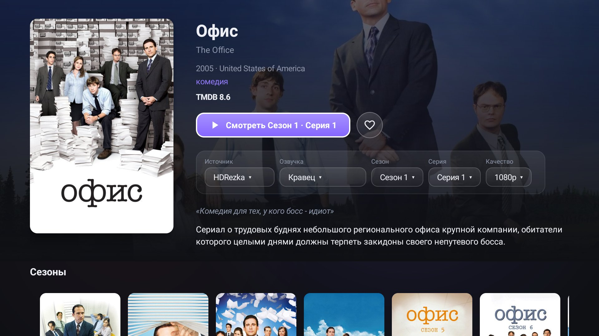
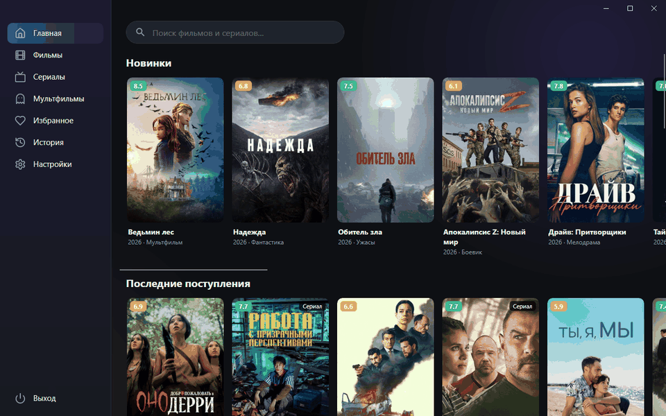

  
  
  

# Фильмы, сериалы, ТВ-шоу и мультфильмы

**Фильмы, сериалы, ТВ-шоу и мультфильмы: открыли каталог, выбрали, нажали «Смотреть».**
Регистрация и аккаунт не нужны. Приложение есть для Android TV, Windows, macOS и Linux: везде один каталог, одни источники видео и три языка (русский, украинский, английский).

🌐 **Сайт:** [cinetv-app.pages.dev](https://cinetv-app.pages.dev/)

<!-- downloads:start -->
### ⬇ Скачать последние версии

| Платформа | Версия | Файлы |
|---|---|---|
| Android TV | 1.8.0 | [arm64-v8a (почти всем)](https://github.com/kholodniakruslan/CineTV-releases/releases/download/android-v1.8.0/CineTV-1.8.0-arm64-v8a.apk) · [armeabi-v7a (старые 32-битные)](https://github.com/kholodniakruslan/CineTV-releases/releases/download/android-v1.8.0/CineTV-1.8.0-armeabi-v7a.apk) |
| Windows | 1.2.0 | [установщик (.exe)](https://github.com/kholodniakruslan/CineTV-releases/releases/download/windows-v1.2.0/CineTV-Setup-1.2.0.exe) · [portable (.zip)](https://github.com/kholodniakruslan/CineTV-releases/releases/download/windows-v1.2.0/CineTV-Portable-1.2.0.zip) |
| macOS | 1.3.0 | [Apple Silicon (.dmg)](https://github.com/kholodniakruslan/CineTV-releases/releases/download/macos-v1.3.0/CineTV-1.3.0-macos-arm64.dmg) · [Intel (.dmg)](https://github.com/kholodniakruslan/CineTV-releases/releases/download/macos-v1.3.0/CineTV-1.3.0-macos-x64.dmg) |
| Linux (Debian 13, x64) | 1.1.0 | [пакет (.deb)](https://github.com/kholodniakruslan/CineTV-releases/releases/download/linux-v1.1.0/CineTV-1.1.0-linux-x64.deb) |

Все версии и заметки к ним: [страница релизов](https://github.com/kholodniakruslan/CineTV-releases/releases).
<!-- downloads:end -->

Как установить, написано в инструкции для вашей платформы:

| | Платформа | Что нужно | Инструкция |
|---|---|---|---|
| 📺 | **Android TV** | Android 10 и новее, ARM, управление пультом | [Читать](android/README.md) |
| 💻 | **Windows** | Windows 10 и новее, 64-бит, мышь и клавиатура | [Читать](windows/README.md) |
| 🍎 | **macOS** | macOS 12 и новее, Apple Silicon или Intel | [Читать](macos/README.md) |
| 🐧 | **Linux** | Debian 13, 64-бит (x64), мышь и клавиатура | Скачайте `.deb` из таблицы выше и выполните `sudo apt install ./CineTV-X.Y.Z-linux-x64.deb`; приложение само не обновляется, новую версию ставьте поверх старой |

---

## Как это выглядит

<table>
  <tr>
    <td> <b>Главная.</b> Новинки в кино и последние поступления</td>
    <td> <b>Фильмы.</b> Плитки с рейтингом, сортировка и жанры</td>
  </tr>
  <tr>
    <td> <b>Страница фильма.</b> Источник, озвучка и качество выбираются прямо здесь</td>
    <td> <b>Страница сериала.</b> Сезон и серия, кнопка «Смотреть Сезон 1 · Серия 1»</td>
  </tr>
</table>

Скриншоты сделаны на Android TV, остальные есть в [инструкции для Android](android/README.md#как-это-выглядит). Скриншоты Windows: [в инструкции для Windows](windows/README.md#как-это-выглядит). На macOS приложение выглядит так же.

---

## Что умеет приложение

- **Большой каталог.** Главная с новинками и популярным, разделы «Фильмы», «Сериалы», «Мультфильмы», жанры и сортировка. Постеры, рейтинги и описания приходят на вашем языке.
- **Поиск** по фильмам и сериалам.
- **Страница фильма или сериала:** описание, актёры, рекомендации, трейлеры.
- **Просмотр без возни.** Выберите озвучку, сезон, серию и качество, а при желании субтитры. Следующая серия включается сама.
- **Несколько источников видео.** Если фильма нет в одном источнике, приложение само попробует другой.
- **«Продолжить просмотр», избранное и история.** Всё хранится на вашем устройстве.
- **Три языка:** русский, украинский, английский. По умолчанию язык берётся из системы.
- **Обновление прямо из приложения:** когда выходит новая версия, приложение предложит её установить.

### Что есть на каких платформах

| | Android TV | Windows | macOS |
|---|:-:|:-:|:-:|
| Каталог, поиск, страница фильма | ✅ | ✅ | ✅ |
| Избранное, история, «Продолжить просмотр» | ✅ | ✅ | ✅ |
| Выбор источника, озвучки, качества, субтитров | ✅ | ✅ | ✅ |
| Обновление из приложения | ✅ | ✅ | ✅ |
| Управление | пульт | мышь и клавиатура | мышь и клавиатура |
| Установка | APK | установщик или zip | образ .dmg |

> **Важно.** Это неофициальное приложение. Оно использует каталог [TMDB](https://www.themoviedb.org/), но не одобрено и не сертифицировано TMDB.
> Само приложение видео не хранит и ничего не загружает на свои серверы: оно показывает то, что находит на сторонних сайтах-источниках.
> Ответственность за просматриваемый контент лежит на вас.

---

## Источники видео

Сейчас это HDRezka, Filmix, UAKino, KinoGo, GidOnline, KinoKong, KinoKrad, UASerials, Eneyida, UAFlix и многие другие.
Лучше всего работают HDRezka, Filmix, UAKino, KinoGo и GidOnline. У KinoKong и KinoKrad плееры пока поддерживаются не полностью,
поэтому видео на них находится не всегда: если фильма там нет, приложение само попробует другой источник.
Некоторые сайты из-за блокировок могут не открываться в вашей сети. Тогда выключите их в **Настройки → Поставщики** или укажите рабочее зеркало.
Хотя бы один поставщик должен остаться включённым.

**Не хватает вашего любимого сайта?** Предложите источник: [форма в Issues](https://github.com/kholodniakruslan/CineTV-releases/issues/new?template=source.yml). Источников можно добавлять, и чаще всего просят то, что нужно многим.

---

## Приватность

- Настройки, история и избранное лежат только на вашем устройстве. Аккаунт не нужен.
- Приложение обращается к TMDB (каталог и постеры), к сайтам-источникам видео и к GitHub (проверка обновлений).
- Обновления предлагаются только для стабильных версий. Перед установкой приложение проверяет контрольную сумму файла (на Android ещё имя пакета и подпись).

---

## Вопросы и ошибки

Сначала загляните в [частые вопросы](FAQ.md). Вопросы и обсуждение: [Discussions](https://github.com/kholodniakruslan/CineTV-releases/discussions). Об ошибке сообщите в [Issues](https://github.com/kholodniakruslan/CineTV-releases/issues) этого репозитория и расскажите:
какая платформа и её версия, какая версия приложения (**Настройки → Обновление приложения**) и что именно не работает.

Здесь лежат только готовые сборки. Исходный код закрыт.

---

Данные о фильмах и сериалах предоставлены TMDB.
